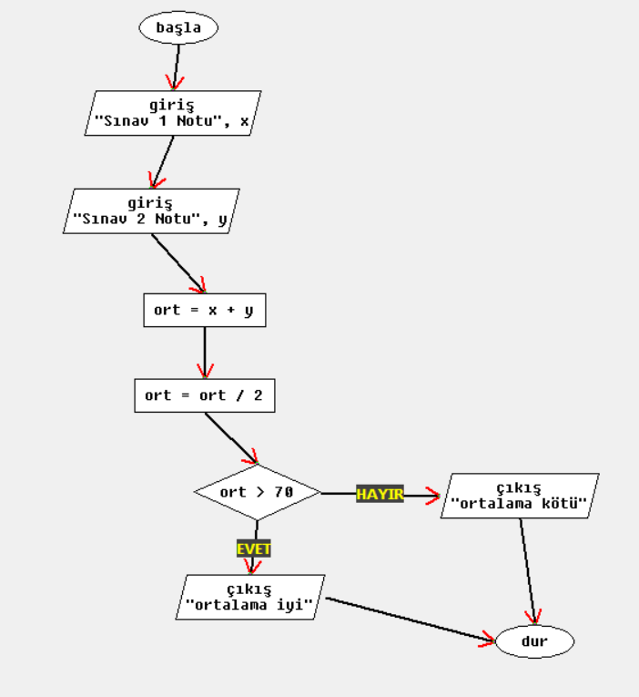
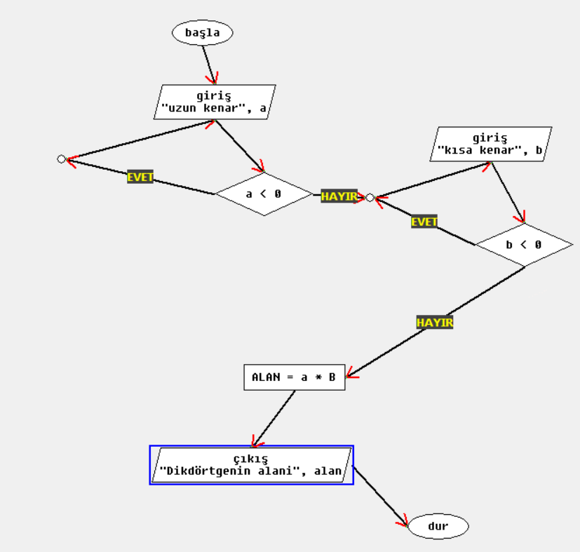
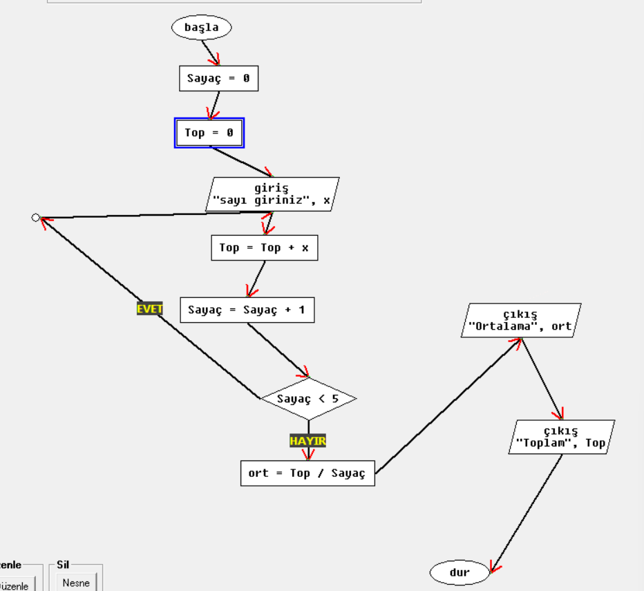
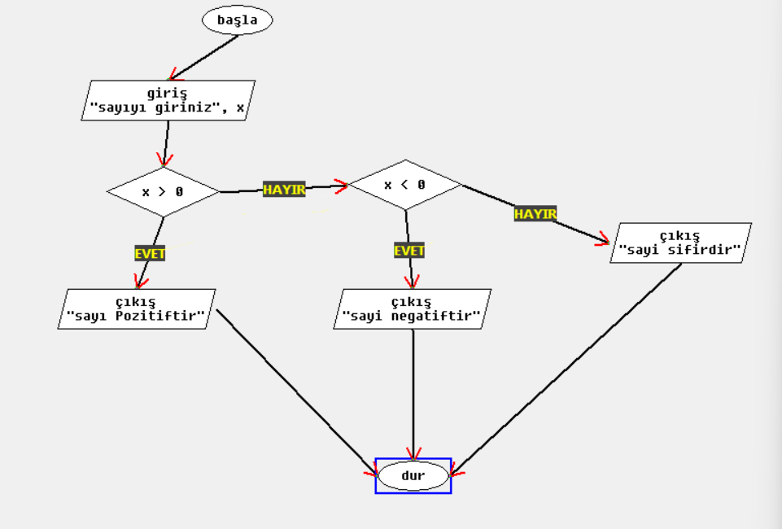
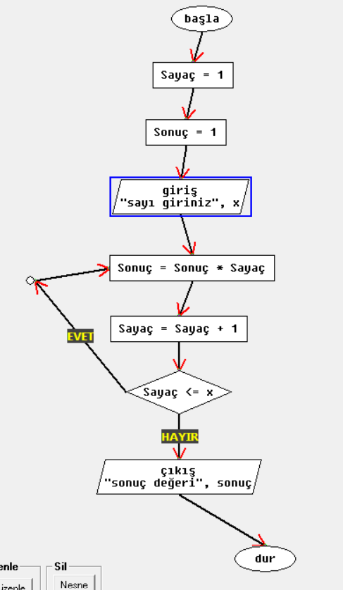
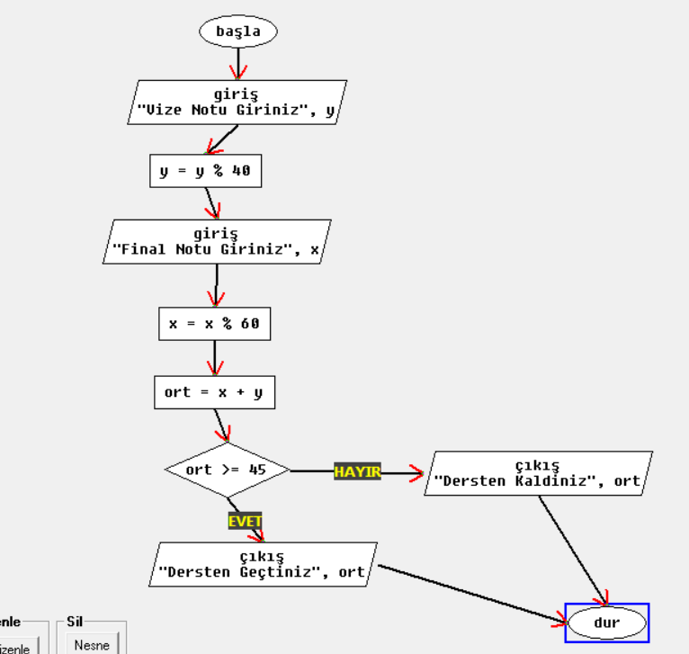
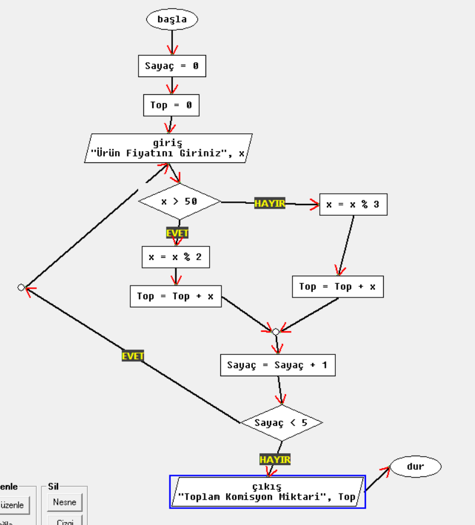
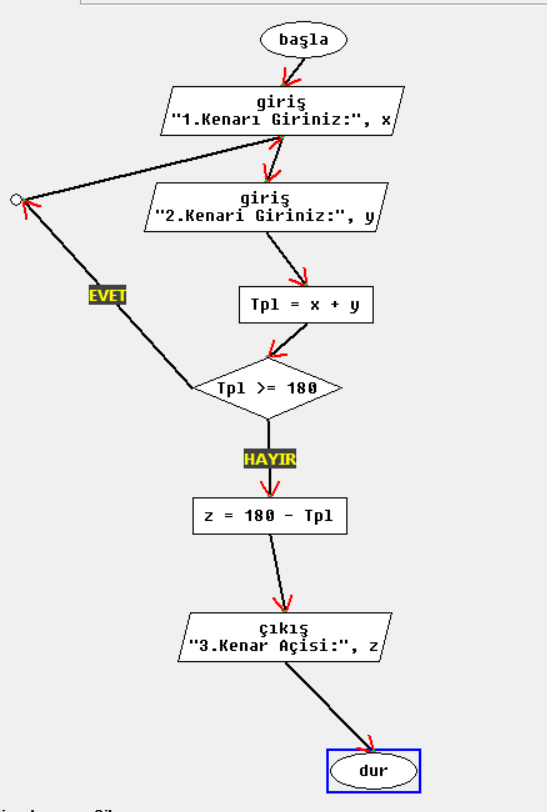
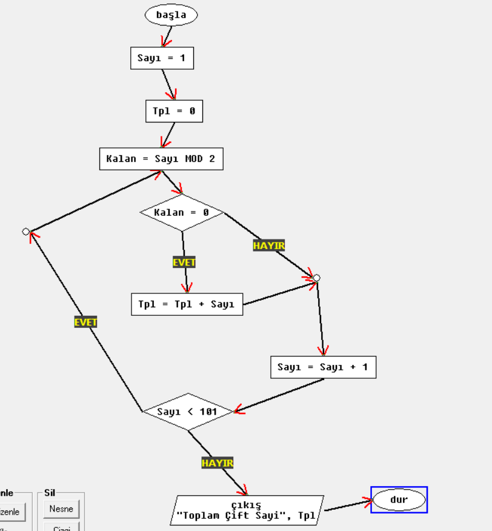

# 02 - Algoritma Eğitimi

Bu bölümde temel algoritmik düşünme ve problem çözme kapsamında Flow Chart uygulaması ile hazırlanan akış şemaları ve proje kaynak dosyaları yer almaktadır.

---

### Akış Şeması 1

### Akış Şeması 2

### Akış Şeması 3

### Akış Şeması 4

### Akış Şeması 5

### Akış Şeması 6

> **Kaynak Dosya:** [flowchart-06.fpp](flowchart-06.fpp)

### Akış Şeması 7

> **Kaynak Dosya:** [flowchart-07.fpp](flowchart-07.fpp)

### Akış Şeması 8

> **Kaynak Dosya:** [flowchart-08.fpp](flowchart-08.fpp)

### Akış Şeması 9

> **Kaynak Dosya:** [flowchart-09.fpp](flowchart-09.fpp)
